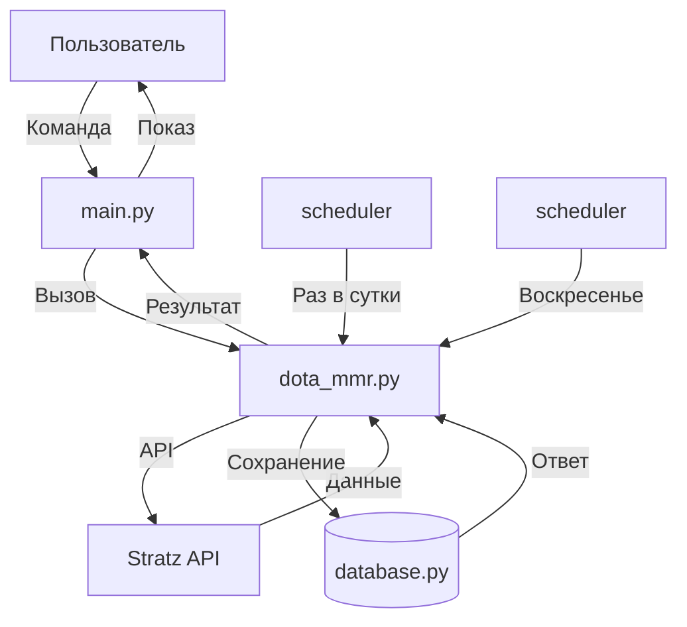

# План интеграции MMR Dota 2

## Архитектура решения



## API для интеграции

### Stratz API (ПРОСТОЙ СПОСОБ - выбран)
- **Поиск по нику**: `https://api.stratz.com/players/{nickname}`
- **Получить MMR**: `https://api.stratz.com/players/{steamId}`
- **Бесплатный**, не требует ключа
- Позволяет искать игроков по никнейму напрямую

### OpenDota API (альтернатива)
- **Endpoint**: `https://api.opendota.com/api/players/{steam_id}/mmr`
- **Бесплатный**, не требует ключа
- Но требует Steam ID, а не никнейм

---

## TODO: Реализация

> **Важно**: весь код Dota 2 в отдельном модуле `dota_mmr.py`, база данных - одна (добавляем поля в существующую таблицу users)

### Этап 1: Подготовка базы данных

- [ ] Добавить поле `steam_id` в таблицу users (integer, nullable)
- [ ] Добавить поле `steam_nickname` в таблицу users (varchar, nullable)
- [ ] Добавить поле `mmr` в таблицу users (integer, default 0)
- [ ] Добавить поле `total_games` в таблицу users (integer, default 0)
- [ ] Добавить поле `wins` в таблицу users (integer, default 0)
- [ ] Добавить поле `week_games` в таблицу users (игр за неделю)
- [ ] Добавить поле `week_wins` в таблицу users (побед за неделю)
- [ ] Добавить поле `week_updated` в таблицу users (дата обновления недельной статистики)
- [ ] Добавить поле `mmr_updated_at` в таблицу users (timestamp)
- [ ] Обновить функцию add_user в database.py
- [ ] Обновить функцию get_user в database.py

### Этап 2: Модуль Dota MMR

- [ ] Создать файл `dota_mmr.py` (отдельный модуль)
- [ ] Функция `search_steam_id(nickname)` - поиск Steam ID по никнейму
- [ ] Функция `get_mmr(steam_id)` - получение MMR из Stratz
- [ ] Функция `get_player_stats(steam_id)` - полная статистика игрока
- [ ] Обработка ошибок и кеширование

### Этап 3: Команды бота

- [ ] Команда `/регистрация <ник или Steam ID>` - привязка Steam
  - Принимает и никнейм (Miracle), и Steam ID (76561198012345678)
  - Перезаписывает старый, если ошиблись
- [ ] Команда `/topmmr` - топ за неделю (игры + винрейт, сбрасывается)
- [ ] Команда `/руинер` - случайный игрок из чата (руинер найден)
- [ ] Обновить кнопку "Моя длина" - добавить MMR в профиль
- [ ] Кнопка "Обновить MMR" в клавиатуре

### Этап 4: Топы по Dota 2

- [ ] Команда `/weektop` - топ за неделю (игры за неделю + винрейт, сбрасывается)
- [ ] Кнопка "Найти руинера" - случайный пользователь из чата
- [ ] Выбирается любой, кто писал в чате за последний день
- [ ] Вывод: 'Руинер найден: @username'
- [ ] Автосброс недельной статистики каждое воскресенье
- [ ] Возможность комбинировать: /mmrtop 10 - показать топ 10

### Этап 4: Автообновление (опционально)

- [ ] Добавить job в job_queue для периодического обновления
- [ ] Обновлять MMR раз в 24 часа для активных игроков
- [ ] Логирование обновлений

### Этап 5: Конфигурация

- [ ] Добавить STEAM_API_KEY в .env.example
- [ ] Добавить инструкцию в README.md

---

## Примеры ответов API

### OpenDota /mmr endpoint
```json
{
  "rank_tier": 80,
  "leaderboard_rank": null,
  "mmr_estimate": {
    "estimate": 5500
  }
}
```

### Stratz API - полная статистика
```json
{
  "steamId": 76561198012345678,
  "nickName": "Miracle",
  "stats": {
    "matchCount": 15000,
    "winCount": 8500,
    "rankTier": 80
  }
}
```

### Rank Tier mapping
- 0-9: Herald
- 10-19: Guardian
- 20-29: Crusader
- 30-39: Archon
- 40-49: Legend
- 50-59: Ancient
- 60-69: Divine
- 70+: Immortal

---

## Пример отображения в профиле

```
👤 Твой профиль

📏 Длина: 150.5 см
🎲 Бросков: 42
🔥 Текущий стрик: 5
🏆 Лучший стрик: 12

🎮 Dota 2
⬆️ MMR: 4500 (Ancient 3)
📊 Матчей: 5234 | Побед: 2800 (53.5%)
🕐 Обновлено: 5 мин назад
```

---

## Примеры топов

### /mmrtop - топ по MMR
```
🏆 Топ игроков по MMR

🥇 1. Miracle - 9500 (Immortal)
🥈 2. Ninjas - 8900 (Immortal)
🥉 3. Ame - 8700 (Immortal)
4. Topson - 8200 (Immortal)
5. Ceb - 7800 (Divine 5)
```

### /topmmr - топ за неделю (сбрасывается каждое воскресенье)
```
🏆 Недельный топ (до воскресенья осталось 3 дня)

🥇 1. Miracle - 45 игр, 68.9% (31-14)
🥈 2. Puppey - 38 игр, 55.3%
🥉 3. Notail - 35 игр, 60.0%

📅 Новый топ начнётся в воскресенье!
```

### Кнопка "Найти руинера"
```
👻 Руинер найден: @username
```

**Логика:**
1. Берём всех, кто писал в чате за последний день
2. Выбираем случайного
3. Отправляем шутку (без привязки к Steam)

**Вариации шуток (для любого пользователя чата):**
1. "_@{user}, ты точно играл, а не смотрел видосы?_"
2. "_@{user}, твоя мама горничная? Потому что ты только и делаешь, что убираешь в команде_"
3. "_@{user}, тебя забанили в киберкафе за то, что много проигрываешь?_"
4. "_@{user}, твои тиммейты плачут, когда ты заходишь в игру_"
5. "_@{user}, это ты или мышка сломалась?_"
6. "_@{user}, мне сказали, что ты хорош... соврали_"
7. "_@{user}, инвайт в команду 'Всегда проигрывает' уже ждёт тебя_"
8. "_@{user}, твоя игра как мид против Рейнджа - всегда проигрываешь_"
9. "_@{user}, Valve должны тебе медаль 'Вклад в поражение команды'_"
10. "_@{user}, ты понимаешь, что твоя команда - это 4 человека и ты?_"
11. "_@{user}, ты играешь так, будто у тебя 100 пинг и 2 FPS_"
12. "_@{user}, твой винрейт как моя скорость интернета - постоянно падает_"
13. "_@{user}, не переживай, ты просто... особенный_"
14. "_@{user}, купил аккаунт или это твой реальный скилл?_"
15. "_@{user}, бабушка твоя в доту играет лучше!_"
16. "_@{user}, {wins}-{losses} - это не статистика, это приговор_"

---

## Приоритеты реализации

1. **База данных** - 1 час
2. **API модуль** - 2 часа  
3. **Команды бота** - 2 часа
4. **Автообновление** - 1 час (опционально)
